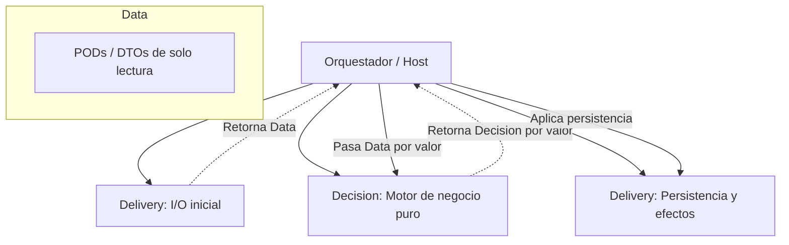

# De POO Tradicional a DDS Slices: Guía de Refactorización

Esta guía documenta el proceso paso a paso para refactorizar lógica de negocio acoplada bajo el paradigma de Programación Orientada a Objetos (POO) hacia el patrón **DDS Slices (Data-Decision-Delivery)**. El objetivo es optimizar el código para arquitecturas limpias y, de manera crucial, facilitar la lectura, mantenimiento y generación de código por parte de agentes de Inteligencia Artificial (IA).

---

## 1. El Problema de la POO Clásica para la IA

En el desarrollo de software tradicional con POO, es común encontrar servicios monolíticos estructurados con Inyección de Dependencias (DI) dinámica y dependencias físicas ocultas tras interfaces.

### El Caso Típico: `OrderService` (C#)

```csharp
public interface IInventoryService
{
    Task<bool> CheckStockAsync(Guid productId, int quantity);
    Task ReserveStockAsync(Guid productId, int quantity);
}

public interface IFinanceService
{
    Task<bool> ValidateCreditLimitAsync(Guid customerId, decimal totalAmount);
    Task ProcessPaymentAsync(Guid customerId, decimal totalAmount);
}

public class OrderService : IOrderService
{
    private readonly IInventoryService _inventoryService;
    private readonly IFinanceService _financeService;
    private readonly ApplicationDbContext _dbContext;

    public OrderService(
        IInventoryService inventoryService,
        IFinanceService financeService,
        ApplicationDbContext dbContext)
    {
        _inventoryService = inventoryService;
        _financeService = financeService;
        _dbContext = dbContext;
    }

    public async Task<OrderResult> CreateOrderAsync(CreateOrderCommand command)
    {
        // 1. Lectura de base de datos
        var customer = await _dbContext.Customers.FindAsync(command.CustomerId);
        if (customer == null)
            throw new InvalidOperationException("Cliente no encontrado.");

        var product = await _dbContext.Products.FindAsync(command.ProductId);
        if (product == null)
            throw new InvalidOperationException("Producto no encontrado.");

        // 2. Validación de negocio externa (Acoplamiento de red/servicios)
        var hasStock = await _inventoryService.CheckStockAsync(command.ProductId, command.Quantity);
        if (!hasStock)
            return OrderResult.Failed("Stock insuficiente.");

        var totalAmount = product.Price * command.Quantity;
        var hasCredit = await _financeService.ValidateCreditLimitAsync(command.CustomerId, totalAmount);
        if (!hasCredit)
            return OrderResult.Failed("Límite de crédito excedido.");

        // 3. Mutación de estado e inicio de efectos colaterales
        var order = new Order
        {
            Id = Guid.NewGuid(),
            CustomerId = command.CustomerId,
            ProductId = command.ProductId,
            Quantity = command.Quantity,
            TotalAmount = totalAmount,
            Status = OrderStatus.Created,
            CreatedAt = DateTime.UtcNow
        };

        await _inventoryService.ReserveStockAsync(command.ProductId, command.Quantity);
        await _financeService.ProcessPaymentAsync(command.CustomerId, totalAmount);

        _dbContext.Orders.Add(order);
        await _dbContext.SaveChangesAsync();

        return OrderResult.Success(order.Id);
    }
}
```

### Por qué esta estructura dificulta el desarrollo con IA

1. **Explosión de Lectura (File Jumping):** Para que una IA entienda o modifique esta lógica, debe leer no solo `OrderService`, sino también `IInventoryService`, `IFinanceService`, las implementaciones concretas de estos, la estructura del `ApplicationDbContext` y el modelo `Order`. Esto satura el contexto del modelo con firmas innecesarias.
2. **Acoplamiento Dinámico en Testing:** Las pruebas unitarias requieren mocks complejos (`Mock<IInventoryService>`, `Mock<IFinanceService>`). La IA suele generar código de test frágil que se rompe ante refactorizaciones menores de firmas.
3. **Impredicibilidad por Efectos de Borde (Side Effects):** La lógica de decisión (validar si se puede ordenar) está entrelazada con llamadas I/O (I/O multiplexado en medio de decisiones). Resulta muy difícil ejecutar la validación de negocio en aislamiento sin desencadenar accesos a la red o base de datos.

---

## 2. El Paradigma DDS (Data-Decision-Delivery)

> [!NOTE]
> **Perfiles DDS.** Esta guía muestra la separación `Data / Decision / Delivery` en su forma **Standard / Strict** (archivos explícitos, contratos claros). Para un **CRUD simple o de bajo riesgo**, el perfil **DDS Lite** basta: mantener la separación conceptual (una función pura de decisión + un adaptador de I/O) sin exigir archivos ni ensamblados separados. La extracción de `Decision` pura se aplica **solo cuando reduce riesgo**. Ver [perfiles en el Manual DDS](DDS_Metodo_Trabajo_IA.md#perfiles-progresivos-lite--standard--strict).

DDS propone estructurar el código en tres capas disjuntas y bien definidas dentro de un único "Slice" (rebanada vertical de lógica):



- **Data:** Estructuras de datos simples (PODs - Plain Old Data), inmutables y libres de comportamiento.
- **Decision:** Funciones estáticas puras. Reciben datos por valor, retornan decisiones por valor. Sin I/O, sin inyección de dependencias.
- **Delivery:** Adaptadores físicos responsables del I/O (Base de datos, HTTP, colas de mensajería).

---

## 3. Paso a Paso de la Refactorización

### Paso 1: Identificar las estructuras de datos (PODs) y separarlas en Data/Contracts

Extraemos todos los parámetros que la decisión de negocio requiere para evaluar su validez. Estas estructuras se definen como tipos por valor inmutables (`readonly record struct` en C#) para favorecer su ubicación en el Stack, mejorar la localidad de memoria en arreglos y reducir la sobrecarga del recolector de basura (Heap allocation).

```csharp
// Contratos de entrada y salida para el motor de decisión (Decision)
public readonly record struct OrderRequest(Guid CustomerId, Guid ProductId, int Quantity);
public readonly record struct ProductDetails(Guid ProductId, decimal Price, bool HasStock, bool Exists);
public readonly record struct CustomerDetails(Guid CustomerId, decimal CreditLimit, bool Exists);

// El resultado de la decisión (inmutable y sin estados intermedios muertos)
public readonly record struct OrderDecision(
    bool IsApproved,
    string RejectionReason,
    decimal TotalAmount
);
```

### Paso 2: Extraer la lógica pura de decisión al Engine (Decision)

El motor de decisión es una clase estática libre de efectos de borde y dependencias externas. Se puede probar en milisegundos sin un solo mock virtual. Toda la lógica de validación de negocio y cálculos reside acá de forma centralizada.

```csharp
public static class OrderEngine
{
    public static OrderDecision Evaluate(
        OrderRequest request, 
        ProductDetails product, 
        CustomerDetails customer)
    {
        // 1. Validaciones de existencia física
        if (!product.Exists)
        {
            return new OrderDecision(false, "Producto no encontrado.", 0.0m);
        }

        if (!customer.Exists)
        {
            return new OrderDecision(false, "Cliente no encontrado.", 0.0m);
        }

        // 2. Validación de regla de inventario
        if (!product.HasStock)
        {
            return new OrderDecision(false, "Stock insuficiente.", 0.0m);
        }

        // 3. Cálculo puro de negocio
        var totalAmount = product.Price * request.Quantity;

        // 4. Validación de regla financiera (Decisión local pura)
        if (customer.CreditLimit < totalAmount)
        {
            return new OrderDecision(false, "Límite de crédito excedido.", totalAmount);
        }

        return new OrderDecision(true, string.Empty, totalAmount);
    }
}
```

### Paso 3: Mover las llamadas físicas de base de datos a adaptadores (Delivery)

Los adaptadores encapsulan la infraestructura de I/O. Ya no hay lógica de decisión ni comparaciones de negocio aquí; solo lecturas atómicas y escrituras de bases de datos. 

> [!NOTE]
> **Compromiso de Cortocircuito (Short-circuiting):** Para mantener la simplicidad y la carga por lote en una única fase de I/O, el adaptador `FetchPreconditionsAsync` carga de manera unificada los datos externos. Si un sistema requiere optimizar llamadas de red de forma estricta ante fallos tempranos (ej. no llamar a Finanzas si no hay stock), se puede segmentar en llamadas secuenciales menores desde el orquestador.

```csharp
public class OrderDelivery
{
    private readonly ApplicationDbContext _dbContext;
    private readonly IInventoryServiceClient _inventoryClient;
    private readonly IFinanceServiceClient _financeClient; // Ahora provee GetAvailableCreditAsync

    public OrderDelivery(
        ApplicationDbContext dbContext,
        IInventoryServiceClient inventoryClient,
        IFinanceServiceClient financeClient)
    {
        _dbContext = dbContext;
        _inventoryClient = inventoryClient;
        _financeClient = financeClient;
    }

    public async Task<(ProductDetails Product, CustomerDetails Customer)> FetchPreconditionsAsync(OrderRequest request)
    {
        // 1. Consultas físicas a base de datos local
        var product = await _dbContext.Products.FindAsync(request.ProductId);
        var customer = await _dbContext.Customers.FindAsync(request.CustomerId);

        // 2. Evaluaciones físicas de existencia antes de llamar a servicios externos
        if (product == null)
        {
            return (
                new ProductDetails(request.ProductId, 0.0m, false, false),
                new CustomerDetails(request.CustomerId, 0.0m, customer != null)
            );
        }

        if (customer == null)
        {
            return (
                new ProductDetails(request.ProductId, product.Price, false, true),
                new CustomerDetails(request.CustomerId, 0.0m, false)
            );
        }

        // 3. I/O contra APIs externas (Trayendo datos crudos necesarios para la decisión)
        var hasStock = await _inventoryClient.CheckStockAsync(request.ProductId, request.Quantity);
        var creditLimit = await _financeClient.GetAvailableCreditAsync(request.CustomerId);

        return (
            new ProductDetails(request.ProductId, product.Price, hasStock, true),
            new CustomerDetails(request.CustomerId, creditLimit, true)
        );
    }

    public async Task<Guid> PersistSuccessOrderAsync(OrderRequest request, OrderDecision decision)
    {
        // Aplicación física de cambios externos e internos en la transacción
        await _inventoryClient.ReserveStockAsync(request.ProductId, request.Quantity);
        await _financeClient.ProcessPaymentAsync(request.CustomerId, decision.TotalAmount);

        var orderId = Guid.NewGuid(); // Generado físicamente en la persistencia
        var order = new Order
        {
            Id = orderId,
            CustomerId = request.CustomerId,
            ProductId = request.ProductId,
            Quantity = request.Quantity,
            TotalAmount = decision.TotalAmount,
            Status = OrderStatus.Created,
            CreatedAt = DateTime.UtcNow
        };

        _dbContext.Orders.Add(order);
        await _dbContext.SaveChangesAsync();

        return orderId; // Se retorna el ID de creación física al orquestador
    }
}
```

### Paso 4: Componer en un orquestador secuencial (Host/Slice)

El orquestador (Handler) une las piezas en un flujo lineal, fácil de leer de arriba a abajo. Administra la secuencia, pasa los datos estrictamente por valor y comunica las fallas o éxitos propagando el identificador del recurso.

```csharp
public class CreateOrderSliceHandler
{
    private readonly OrderDelivery _delivery;

    public CreateOrderSliceHandler(OrderDelivery delivery)
    {
        _delivery = delivery;
    }

    public async Task<OrderResult> HandleAsync(CreateOrderCommand command)
    {
        var request = new OrderRequest(command.CustomerId, command.ProductId, command.Quantity);

        // 1. Obtener datos iniciales (I/O - Delivery)
        var (product, customer) = await _delivery.FetchPreconditionsAsync(request);

        // 2. Ejecutar decisión pura (Cálculo matemático sin I/O - Decision)
        var decision = OrderEngine.Evaluate(request, product, customer);

        // 3. Tratar resultado y aplicar persistencia si es exitoso
        if (!decision.IsApproved)
        {
            return OrderResult.Failed(decision.RejectionReason);
        }

        // Retorno seguro de la identidad de la orden creada
        var orderId = await _delivery.PersistSuccessOrderAsync(request, decision);

        return OrderResult.Success(orderId);
    }
}
```

---

## 4. Comparación de Código: Antes vs. Después

> [!NOTE]
> La siguiente tabla expresa **expectativas heurísticas** del método DDS, no mediciones probadas. La dirección y magnitud reales de cada dimensión deben validarse por caso de uso (ver el [Prospecto Medible](DDS_Metodo_Trabajo_IA.md#prospecto-medible-hipótesis-a-validar)).

| Métrica / Dimensión | POO Clásica (Inyectada) | DDS Slice (Estructurado) |
| :--- | :--- | :--- |
| **Flujo de Ejecución** | Entrelazado (Lectura -> Validación -> Escritura -> Validación -> Escritura). | Lineal y secuencial (Lectura -> Decisión -> Escritura). |
| **Pruebas del Motor de Negocio** | Complejas. Requieren configurar mocks para base de datos y servicios remotos. | Triviales. Entrada por valor, aserción de salida por valor (`Assert.Equal`). |
| **Facilidad para la IA** | **Baja**. Debe entender el grafo completo de interfaces y dependencias. | **Alta**. La lógica está confinada a una función pura (`Evaluate`). |
| **Acoplamiento de I/O** | Alto. El servicio depende directamente del DbContext y servicios remotos. | Bajo. La base de datos y clientes HTTP están aislados en el adaptador `Delivery`. |

---

## Tamaño y Nombre del Slice

Antes de refactorizar, conviene fijar el **límite del slice**. Un slice representa una **razón de cambio / capacidad**, no necesariamente una tabla o entidad:

| Contexto | Granularidad típica |
| :--- | :--- |
| CRUD simple | `ProductManagement`, `CustomerManagement` son válidos. |
| Dominios de negocio | `Inventory`, `Sales`, `Billing` suelen ser mejores que `Customer` / `Product` / `Order` cuando esas entidades son solo datos compartidos dentro de una capacidad mayor. |
| Flujos muy complejos | Sub-slices / slices por caso de uso como `ApproveRefund`, `CancelSale` pueden justificarse. |

> Una entidad por slice **no es automáticamente incorrecta**; simplemente **no es automática**. Se dimensiona por capacidad y por el radio de explosión del refactor, no por la cantidad de tablas.

---

## Conclusion

Refactorizar código POO hacia **DDS Slices** busca reducir el acoplamiento dinámico que dificulta el análisis estático. Al segmentar claramente los datos de la decisión y la entrega, se provee un entorno que *aspira a* tener menos ambigüedades, donde se espera que un agente de IA pueda generar nuevas características o corregir bugs modificando únicamente la capa relevante del Slice, *con el objetivo de* reducir los errores de regresión y optimizar el uso de tokens. Estos beneficios son hipótesis a validar mediante ejemplos y benchmarks (ver el [Prospecto Medible](DDS_Metodo_Trabajo_IA.md#prospecto-medible-hipótesis-a-validar)).
