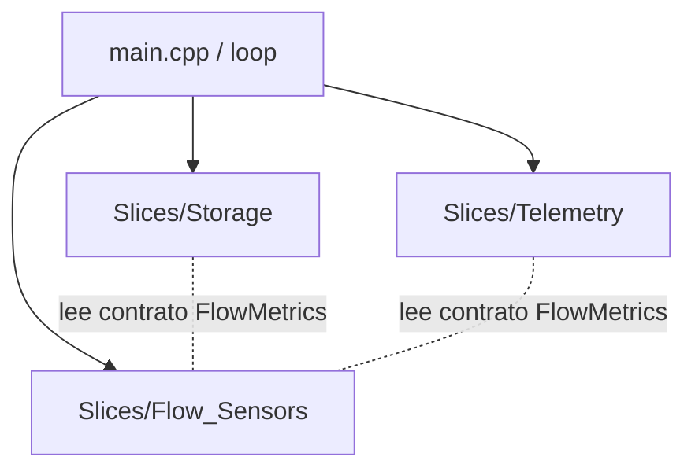

# DDS en Sistemas Embebidos: Guía de Arquitectura para Firmware de Ultra-Alto Rendimiento (DoD + Slices)

Este documento formaliza el estándar **Data-Driven Slices (DDS)** para sistemas embebidos de recursos limitados (como ESP32, ESP8266 o STM32), aplicando **Data-Oriented Design (DoD)** de forma pura. Su propósito es estructurar firmware robusto, inmune a la fragmentación de memoria y optimizado para el desarrollo autónomo con Inteligencia Artificial.

---

## Decisiones de Arquitectura para Hardware

| Concepto | Decisión de Diseño | Razón Técnica |
| :--- | :--- | :--- |
| **Prevención de Crashes** | **Cero Heap en Runtime.** Se prohíbe el uso de `new`, `malloc` y la clase `String` una vez iniciado el `loop()`. | Evita la fragmentación de la memoria RAM, causa principal de fallos espontáneos (OOM) en microcontroladores. |
| **Alineación de Caché/Vtables** | **Cero Polimorfismo Dinámico.** Sin métodos `virtual` ni tablas de punteros (`vtables`). | Reduce el consumo de RAM (4 bytes por instancia) y permite optimizaciones agresivas en el compilador de GCC. |
| **Frontera de Inicialización** | Cada Slice expone una función de inicialización pública `init_<slice>()` llamada en la fase de `setup()`. | Mantiene `main.cpp` libre de detalles físicos sobre asignación de pines GPIO, registros internos y drivers. |
| **Paso de Datos por Valor** | Los datos fluyen como copias de estructuras planas y de solo lectura (PODs) administradas por el orquestador. | Elimina el estado global mutable y acopla de forma asíncrona la lectura de sensores, almacenamiento y red. |

---

## El Caso de Uso: Caudalímetro Diferencial para Detección de Fugas (Leak Detector)

Para explicar el método de forma pública y genérica, utilizaremos un **Detector de Fugas de Agua Diferencial**. El dispositivo cuenta con dos sensores de flujo de turbina físicos colocados en extremos opuestos de una tubería:

1.  **Sensor de Entrada (Inflow Sensor):** Cuenta el volumen de agua ingresado mediante pulsos físicos (interrupción GPIO).
2.  **Sensor de Salida (Outflow Sensor):** Cuenta el volumen de agua egresado mediante pulsos físicos (interrupción GPIO).

**Reglas de negocio del dispositivo:**
- El firmware debe detectar si la diferencia acumulada entre entrada y salida supera un umbral crítico (fuga).
- Ambos contadores deben persistirse de forma segura en la memoria EEPROM para no perder el estado físico ante cortes de energía.
- El dispositivo debe reportar la telemetría acumulada (pulsos y litros calculados) periódicamente a través de una petición HTTP.

### Estructura del Grafo de Dependencias (Unidireccional)



> [!NOTE]
> `/core` queda **vacío** en este ejemplo. Las métricas de flujo (`FlowMetrics`) son datos de dominio del dispositivo (sensores/telemetría), **no** infraestructura, por lo que viven en el contrato del slice `flow_sensors` y no en `/core`.

---

## Respuestas de Diseño a las Limitaciones del Hardware

### 1. ¿Cómo se aísla el Setup de cada Slice sin compartir estado?
Cada Slice expone en su cabecera pública (`contracts.hpp`) únicamente una función de inicialización limpia: `void init_<slice>()`. Toda la lógica de configuración física —como definir modos de pines con `pinMode`, acoplar resistencias de pull-up, asociar rutinas de servicio de interrupción (`attachInterrupt`) o inicializar buses de hardware (I2C/SPI)— se encapsula de manera privada en el archivo `.cpp` del slice. El archivo `main.cpp` actúa únicamente como un secuenciador ciego que las invoca al iniciar. Si un pin cambia o se reemplaza un driver físico, el cambio se contiene completamente dentro del slice sin romper el orquestador principal.

### 2. ¿Cómo se evita la fragmentación de memoria en microcontroladores?
La fragmentación en chips como el ESP8266 ocurre cuando se asigna y libera memoria dinámica de forma repetida (por ejemplo, al manipular objetos `String` o deserializar JSON en el Heap). DDS mitiga esto prohibiendo terminantemente la memoria dinámica tras la inicialización:
- Todos los buffers de serialización de red se preasignan en el Stack como arrays de caracteres fijos (`char payload[128]`).
- Se utilizan funciones seguras como `snprintf` para el formateo de strings.
- Los datos compartidos entre componentes se pasan estrictamente por valor o por referencia constante a estructuras estáticas.

### 3. ¿Cómo manejan las interrupciones los contadores sin crear variables globales mutables acopladas?
En arquitectura DoD, las rutinas de servicio de interrupción (ISR) se tratan como simples capturadores de eventos físicos de bajísimo nivel. 
- Los contadores volátiles e inestables residen únicamente dentro del ámbito privado de implementación (`delivery.cpp`) del Slice de sensores. Ningún otro componente puede verlos ni modificarlos.
- El Slice de sensores ofrece una función pública no bloqueante `poll_and_clear_flow()`. 
- Dentro de esta función, se abre una sección crítica extremadamente corta (deshabilitando interrupciones por fracciones de microsegundo) para copiar el estado volátil a una estructura local plana (`FlowEvent`) y restablecer los contadores de la ISR.
- El orquestador (`main.cpp`) recibe este paquete de datos por valor, actualiza el estado general en RAM y lo inyecta a los Slices de almacenamiento (`Storage`) y red (`Telemetry`). De esta forma, el código de la EEPROM y el de HTTP son completamente ciegos a las interrupciones físicas y a la asignación de pines.

---

## Implementación de Referencia (C++ / PlatformIO)

### 1. `/core` vacío (solo infraestructura)

En DDS, el directorio `/core` es de **infraestructura**, no de dominio: debe permanecer aburrido y casi vacío. Para este ejemplo embebido no se requiere ningún tipo técnico compartido (no hay transacciones de base de datos ni handles opacos), por lo que **`/core` queda vacío**.

Las métricas de flujo acumuladas (`FlowMetrics`) **no** son infraestructura: son datos de dominio del dispositivo (sensores/telemetría). Por eso se definen en el contrato del slice que es fuente de verdad de los datos de flujo — `slices/flow_sensors/contracts.hpp` — y `Storage`/`Telemetry` consumen ese contrato cuando necesitan el tipo. Esto evita meter datos de negocio en `/core`, que es exactamente el antipatrón que DDS prohíbe.

### 2. Slice de Sensores de Caudal (`flow_sensors`)

#### Cabecera Pública:
```cpp
// slices/flow_sensors/contracts.hpp (PÚBLICO)
#pragma once
#include <cstdint>

namespace slices::flow_sensors {

// Métricas acumuladas del dispositivo.
// Datos de dominio del slice de sensores (NO viven en /core: son telemetría/sensores,
// no infraestructura). Storage y Telemetry consumen este tipo vía este contrato.
struct FlowMetrics {
    uint32_t inflow_pulses;
    uint32_t outflow_pulses;
    uint32_t inflow_liters;
    uint32_t outflow_liters;
};

// Estructura de eventos devuelta al orquestador principal
struct FlowEvent {
    bool has_new_pulses;
    uint32_t inflow_delta;
    uint32_t outflow_delta;
};

// Inicializa pines físicos e interrupciones (ISRs)
void init_flow_sensors();

// Lee de forma segura los contadores de las ISRs y los reinicia
FlowEvent poll_and_clear_flow();

} // namespace slices::flow_sensors
```

#### Motor de Lógica Pura (Privado):
```cpp
// slices/flow_sensors/engine.hpp (PRIVADO)
#pragma once
#include <cstdint>

namespace slices::flow_sensors {
    // Lógica pura de validación matemática de debounce (DoD) sin dependencias de hardware
    inline bool validate_debounce(uint32_t current_time, uint32_t last_time, uint32_t interval) {
        return (current_time - last_time) >= interval;
    }
}
```

#### Adaptador Físico (Privado):
```cpp
// slices/flow_sensors/delivery.cpp (PRIVADO)
#include "contracts.hpp"
#include "engine.hpp"
#include <Arduino.h>

// Definición de Pines Físicos
#define INFLOW_PIN 4   // GPIO4 (D2 en ESP8266)
#define OUTFLOW_PIN 5  // GPIO5 (D1 en ESP8266)
#define DEBOUNCE_MS 20 // Ventana de debounce en milisegundos

// Variables volátiles de las ISRs
static volatile uint32_t volatile_inflow_count = 0;
static volatile uint32_t volatile_outflow_count = 0;
static volatile uint32_t last_inflow_time = 0;
static volatile uint32_t last_outflow_time = 0;
static volatile bool new_activity_flag = false;

// ISR para el caudalímetro de entrada (almacenada en la sección IRAM)
void IRAM_ATTR handle_inflow_interrupt() {
    uint32_t now = millis();
    if (slices::flow_sensors::validate_debounce(now, last_inflow_time, DEBOUNCE_MS)) {
        volatile_inflow_count++;
        last_inflow_time = now;
        new_activity_flag = true;
    }
}

// ISR para el caudalímetro de salida (almacenada en la sección IRAM)
void IRAM_ATTR handle_outflow_interrupt() {
    uint32_t now = millis();
    if (slices::flow_sensors::validate_debounce(now, last_outflow_time, DEBOUNCE_MS)) {
        volatile_outflow_count++;
        last_outflow_time = now;
        new_activity_flag = true;
    }
}

namespace slices::flow_sensors {

void init_flow_sensors() {
    pinMode(INFLOW_PIN, INPUT_PULLUP);
    pinMode(OUTFLOW_PIN, INPUT_PULLUP);
    
    attachInterrupt(digitalPinToInterrupt(INFLOW_PIN), handle_inflow_interrupt, FALLING);
    attachInterrupt(digitalPinToInterrupt(OUTFLOW_PIN), handle_outflow_interrupt, FALLING);
}

FlowEvent poll_and_clear_flow() {
    FlowEvent event{ false, 0, 0 };
    
    if (!new_activity_flag) {
        return event;
    }
    
    // Sección crítica ultra corta: bloquea interrupciones físicas para copiar datos volátiles
    noInterrupts();
    event.has_new_pulses = true;
    event.inflow_delta = volatile_inflow_count;
    event.outflow_delta = volatile_outflow_count;
    
    // Limpieza de contadores volátiles internos
    volatile_inflow_count = 0;
    volatile_outflow_count = 0;
    new_activity_flag = false;
    interrupts(); // Fin de la sección crítica
    
    return event;
}

} // namespace slices::flow_sensors
```

### 3. Slice de Almacenamiento Local (`storage`)

#### Cabecera Pública:
```cpp
// slices/storage/contracts.hpp (PÚBLICO)
#pragma once
#include "../flow_sensors/contracts.hpp" // FlowMetrics pertenece al slice de sensores

namespace slices::storage {

// Configura el driver de EEPROM física
void init_storage();

// Lee los totales almacenados de forma segura
slices::flow_sensors::FlowMetrics read_stored_metrics();

// Escribe físicamente en memoria no volátil
void write_stored_metrics(const slices::flow_sensors::FlowMetrics& metrics);

} // namespace slices::storage
```

#### Adaptador Físico (Privado):
```cpp
// slices/storage/delivery.cpp (PRIVADO)
#include "contracts.hpp"
#include <EEPROM.h>

#define EEPROM_SIZE 512
#define EEPROM_ADDR 0

namespace slices::storage {

void init_storage() {
    EEPROM.begin(EEPROM_SIZE);
}

slices::flow_sensors::FlowMetrics read_stored_metrics() {
    slices::flow_sensors::FlowMetrics metrics{ 0, 0, 0, 0 };
    EEPROM.get(EEPROM_ADDR, metrics);
    
    // Resguardo ante EEPROM virgen o corrupta (devuelve 0xFFFFFFFF)
    if (metrics.inflow_pulses == 0xFFFFFFFF || metrics.outflow_pulses == 0xFFFFFFFF) {
        metrics = { 0, 0, 0, 0 };
    }
    return metrics;
}

void write_stored_metrics(const slices::flow_sensors::FlowMetrics& metrics) {
    EEPROM.put(EEPROM_ADDR, metrics);
    EEPROM.commit(); // Persistencia física en memoria Flash
}

} // namespace slices::storage
```

### 4. Slice de Telemetría HTTP (`telemetry`)

#### Cabecera Pública:
```cpp
// slices/telemetry/contracts.hpp (PÚBLICO)
#pragma once
#include "../flow_sensors/contracts.hpp" // FlowMetrics pertenece al slice de sensores

namespace slices::telemetry {

// Configura la interfaz de red WiFi
void init_telemetry(const char* ssid, const char* password);

// Envía la telemetría acumulada por red de forma no bloqueante
bool send_telemetry_http(const slices::flow_sensors::FlowMetrics& metrics);

} // namespace slices::telemetry
```

#### Adaptador Físico (Privado):
```cpp
// slices/telemetry/delivery.cpp (PRIVADO)
#include "contracts.hpp"
#include <ESP8266WiFi.h>
#include <ESP8266HTTPClient.h>
#include <WiFiClient.h>

static const char* server_url = "http://api.leakdetector.internal/v1/telemetry";

namespace slices::telemetry {

void init_telemetry(const char* ssid, const char* password) {
    WiFi.begin(ssid, password);
}

bool send_telemetry_http(const slices::flow_sensors::FlowMetrics& metrics) {
    if (WiFi.status() != WL_CONNECTED) {
        return false; // Fallo controlado ante pérdida de red
    }

    WiFiClient client;
    HTTPClient http;
    
    http.begin(client, server_url);
    http.addHeader("Content-Type", "application/json");

    // Formateo seguro en buffer estático local (Cero allocation en Heap)
    char payload[128];
    snprintf(payload, sizeof(payload), 
             "{\"in_p\":%u,\"out_p\":%u,\"in_l\":%u,\"out_l\":%u}", 
             metrics.inflow_pulses, metrics.outflow_pulses, 
             metrics.inflow_liters, metrics.outflow_liters);

    int http_code = http.POST(payload);
    http.end();

    return http_code == HTTP_CODE_OK;
}

} // namespace slices::telemetry
```

### 5. Orquestador / Composición Principal (`main.cpp`)

Este archivo es el único punto donde se orquesta el flujo de datos. No contiene lógica de bajo nivel, interrupciones, lógica de red ni direccionamiento EEPROM; simplemente pasa los datos planos de un componente a otro.

```cpp
// main.cpp (Composition Root / Host Application)
#include <Arduino.h>
#include "slices/flow_sensors/contracts.hpp"
#include "slices/storage/contracts.hpp"
#include "slices/telemetry/contracts.hpp"

// Factor de conversión del sensor (por ejemplo, 450 pulsos por litro)
#define PULSES_PER_LITER 450
#define UMBRAL_FUGA_LITROS 5 // Alerta si hay desfase mayor a 5 litros

// Estado en memoria de la aplicación (DoD: datos agrupados)
static slices::flow_sensors::FlowMetrics system_metrics;
static uint32_t last_telemetry_time = 0;
const uint32_t TELEMETRY_INTERVAL_MS = 60000; // Envío cada 60 segundos

void setup() {
    // 1. Inicialización limpia de cada Slice de hardware de manera aislada
    slices::storage::init_storage();
    slices::flow_sensors::init_flow_sensors();
    slices::telemetry::init_telemetry("WiFi_Segura_IoT", "PasswordDificil123");

    // 2. Carga inicial de datos históricos acumulados desde la memoria flash
    system_metrics = slices::storage::read_stored_metrics();
}

void loop() {
    // FASE I: Sondeo y recolección no bloqueante de pulsos físicos
    auto flow_data = slices::flow_sensors::poll_and_clear_flow();

    if (flow_data.has_new_pulses) {
        // FASE II: Procesamiento y actualización del estado en RAM
        system_metrics.inflow_pulses += flow_data.inflow_delta;
        system_metrics.outflow_pulses += flow_data.outflow_delta;
        
        system_metrics.inflow_liters = system_metrics.inflow_pulses / PULSES_PER_LITER;
        system_metrics.outflow_liters = system_metrics.outflow_pulses / PULSES_PER_LITER;

        // Comprobación de fuga (do de la lógica diferencial de negocio)
        if (system_metrics.inflow_liters > (system_metrics.outflow_liters + UMBRAL_FUGA_LITROS)) {
            // Acción de contingencia directa (por ejemplo, apagar un relé o setear un flag)
        }

        // FASE III: Persistencia del nuevo estado ante cada ráfaga confirmada
        slices::storage::write_stored_metrics(system_metrics);
    }

    // FASE IV: Telemetría temporal programada
    uint32_t now = millis();
    if (now - last_telemetry_time >= TELEMETRY_INTERVAL_MS) {
        bool sent = slices::telemetry::send_telemetry_http(system_metrics);
        if (sent) {
            last_telemetry_time = now;
        }
    }

    yield(); // Resetea el hardware watchdog del chip para prevenir reinicios accidentales
}
```
