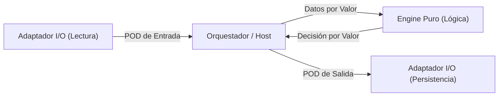

# Estándar de Testing Unitario Puro bajo DoD y DDS (Zero-Mocks Suite)

Este documento define el estándar técnico para el diseño y ejecución de pruebas unitarias dentro del marco de **Diseño Orientado a Datos (DoD - Data-Oriented Design)** y **Data-Driven Slices (DDS)**. El objetivo principal es establecer una suite de pruebas de alta velocidad, determinista y **libre de mocks dinámicos para la capa `Decision` / `Engine`** (Zero-Mocks Suite).

> [!IMPORTANT]
> **Alcance de la política Zero-Mocks.** Los mocks dinámicos están **prohibidos / fuertemente desaconsejados para las pruebas de `Decision` / `Engine`**. La capa `Delivery` (API, base de datos, mensajería) **sí puede** usar test doubles controlados — fakes, testcontainers, servidores HTTP falsos o tests de contrato — cuando validan **comportamiento observable**, no la coreografía interna de llamadas. Ver [sección 5](#5-política-de-test-doubles-para-la-capa-delivery).

---

## 1. El Carácter Matemático y Determinista del Testing en DoD

En DoD, la lógica de negocio se modela a través de **funciones puras** y **motores estáticos (Engines)**. La computación se desvincula de la gestión del estado y de los efectos secundarios.

### Principios Fundamentales:
* **Entradas y Salidas Planas:** Las funciones reciben estructuras de datos puras (Data Transfer Objects o estructuras planas/PODs) y devuelven nuevas estructuras de datos. No hay comportamiento encapsulado con estado mutable dentro de estos objetos.
* **Determinismo Absoluto:** A igual entrada, igual salida ($f(x) = y$). No existen dependencias del estado global, del tiempo de ejecución del sistema, ni de configuraciones de red o archivos.
* **Simplicidad Matemática:** Evaluar el comportamiento de un Engine se reduce a comparar valores de estructuras resultantes contra valores esperados. Esto *reduce* la necesidad de verificar interacciones (behavior testing) en favor de verificar resultados (state testing).

---

## 2. El Anti-patrón de Mocking Dinámico

El uso de frameworks de mocking dinámico (como Moq o NSubstitute en ambientes administrados que dependen de reflexión y proxies dinámicos en tiempo de ejecución, o incluso gMock en C++ que genera acoplamiento y lentitud de compilación mediante plantillas y macros) para aislar la lógica de negocio es un síntoma de un acoplamiento de diseño deficiente.

### Problemas del Mocking Dinámico:
1. **Enmascaramiento de Acoplamiento Temporal y de Comportamiento:** Los mocks permiten simular llamadas de métodos en interfaces complejas. Esto a menudo oculta el hecho de que una clase tiene demasiadas responsabilidades y depende de la secuencia de ejecución interna de otra.
2. **Fragilidad ante Refactorizaciones:** Al mockear interacciones (ej. verificar que un método `Save()` fue llamado exactamente una vez), cualquier cambio en la estructura interna de la implementación rompe el test, incluso si el resultado final de negocio sigue siendo correcto.
3. **Degradación de la Velocidad de Testeo:** La inicialización de proxies dinámicos y la reflexión en tiempo de ejecución ralentizan significativamente la suite de pruebas en entornos administrados (.NET, JVM, Node).
4. **Barrera para la Autoreparación de la IA:** Cuando una IA intenta corregir código roto, los mocks dinámicos introducen una carga cognitiva enorme debido a las dependencias implícitas del comportamiento esperado de los mocks. La IA debe entender tanto el mock como la implementación para corregir el test, aumentando la probabilidad de falsos positivos o bucles de corrección fallidos.

---

## 3. Aislamiento de Efectos Colaterales (Base de Datos y APIs)

Para testear la lógica de negocio sin latencia ni efectos de red, se aplica una separación de responsabilidades donde el orquestador recupera los datos planos y alimenta al Engine puro, desacoplando completamente la base de datos de las decisiones lógicas.



### Estrategia de Aislamiento:
1. **Carga e Ingesta:** Los adaptadores de infraestructura (base de datos, clientes HTTP) recuperan la información y la proyectan a estructuras planas de datos (estructuras de entrada).
2. **Procesamiento Puro:** El Engine procesa estas estructuras planas. Esta fase no tiene conocimiento de cómo se obtuvieron los datos ni de cómo se guardarán.
3. **Aplicación de Efectos:** La salida del Engine (otra estructura plana) es tomada por el adaptador de infraestructura para persistirla o transmitirla.

De esta forma, la suite de pruebas unitarias testea el **Engine** con datos puros, mientras que las pruebas de los adaptadores de infraestructura se delegan a tests de integración específicos y aislados.

---

## 4. Ejemplos Concretos de Testeo sobre Engines Puros

A continuación se muestra un ejemplo en C# / .NET donde se testea el cálculo de tarifas y penalizaciones de un motor de reservas sin usar mocks, inicializando structs planos directamente.

### Definición de Estructuras y Engine

```csharp
// Estructuras de datos planas (PODs en formato de structs de solo lectura por valor)
public readonly record struct BookingInput(
    decimal BasePrice, 
    int DaysBeforeCheckIn, 
    bool IsPremiumMember
);

public readonly record struct CancellationResult(
    decimal RefundAmount, 
    decimal PenaltyFee, 
    bool IsPolicyViolated
);

// Engine Puro (Sin dependencias, sin estado mutable, sin allocations en el Heap)
public static class CancellationEngine
{
    public static CancellationResult CalculateRefund(BookingInput booking)
    {
        if (booking.DaysBeforeCheckIn < 2)
        {
            return new CancellationResult(
                RefundAmount: 0.0m, 
                PenaltyFee: booking.BasePrice * 0.5m, 
                IsPolicyViolated: true
            );
        }

        decimal penaltyRate = booking.IsPremiumMember ? 0.0m : 0.1m;
        decimal penalty = booking.BasePrice * penaltyRate;
        decimal refund = booking.BasePrice - penalty;

        return new CancellationResult(
            RefundAmount: refund, 
            PenaltyFee: penalty, 
            IsPolicyViolated: false
        );
    }
}
```

### Suite de Pruebas Unitarias (Zero-Mocks)

```csharp
using Xunit;

public class CancellationEngineTests
{
    [Fact]
    public void PremiumMember_CancelingWithTime_GetsFullRefund()
    {
        // 1. Configuración del escenario simplemente inicializando structs planos
        var input = new BookingInput(
            BasePrice: 100.0m,
            DaysBeforeCheckIn: 5,
            IsPremiumMember: true
        );

        // 2. Ejecución de la función pura
        var result = CancellationEngine.CalculateRefund(input);

        // 3. Verificación matemática del estado del resultado
        Assert.Equal(100.0m, result.RefundAmount);
        Assert.Equal(0.0m, result.PenaltyFee);
        Assert.False(result.IsPolicyViolated);
    }

    [Fact]
    public void StandardMember_CancelingWithTime_GetsTenPercentPenalty()
    {
        var input = new BookingInput(
            BasePrice: 100.0m,
            DaysBeforeCheckIn: 5,
            IsPremiumMember: false
        );

        var result = CancellationEngine.CalculateRefund(input);

        Assert.Equal(90.0m, result.RefundAmount);
        Assert.Equal(10.0m, result.PenaltyFee);
        Assert.False(result.IsPolicyViolated);
    }

    [Fact]
    public void StandardMember_CancelingLate_GetsPenalty()
    {
        var input = new BookingInput(
            BasePrice: 200.0m,
            DaysBeforeCheckIn: 1,
            IsPremiumMember: false
        );

        var result = CancellationEngine.CalculateRefund(input);

        Assert.Equal(0.0m, result.RefundAmount);
        Assert.Equal(100.0m, result.PenaltyFee);
        Assert.True(result.IsPolicyViolated);
    }
}
```

---

## 5. Política de Test Doubles para la capa Delivery

La política Zero-Mocks aplica a la capa **`Decision` / `Engine`** (lógica pura). La capa **`Delivery`** (base de datos, APIs HTTP, colas de mensajería) requiere validar integración con el mundo real y **sí admite** dobles de prueba controlados, bajo las siguientes reglas:

| Permitido para Delivery | Prohibido / Fuertemente desaconsejado |
| :--- | :--- |
| **Fakes** en memoria que implementan el mismo contrato (ej. un `InMemoryOrderRepository`). | Mocks dinámicos que verifican **coreografía interna** de llamadas (ej. "se llamó a `Save()` exactamente una vez y luego a `Log()`"). |
| **Testcontainers** / bases efímeras reales. | Mocks que acoplan el test a la estructura interna de la implementación. |
| **Servidores HTTP falsos** (WireMock, etc.) que devuelven respuestas fijas. | Sustituir la validación de **resultados** por validación de **interacciones**. |
| **Tests de contrato** sobre el comportamiento observable. | Fakes que reimplementan la lógica de negocio del Engine (la lógica ya está testeada en los tests del Engine). |

### Principio rector

> **Validar resultados (state testing), no coreografía (behavior testing).** Un doble de prueba es aceptable cuando permite afirmar *“dada esta entrada, el sistema produjo este efecto observable en el mundo”*. Es frágil cuando afirma *“se llamó a los métodos en este orden exacto”*.

### Anti-patrón: mock frágil vs. fake controlado

```csharp
// ❌ FRÁGIL: verifica coreografía interna. Se rompe ante cualquier refactor.
mockRepo.Verify(r => r.Save(order), Times.Once);
mockLog.Verify(l => l.Info("created"), Times.Once);

// ✅ ROBUSTO: valida comportamiento observable mediante un fake en memoria.
var fakeRepo = new InMemoryOrderRepository();
var delivery = new OrderDelivery(fakeRepo);
await delivery.PersistSuccessOrderAsync(request, decision);

var saved = fakeRepo.GetSinglePersisted();
Assert.Equal(decision.TotalAmount, saved.TotalAmount); // se afirma el resultado
```

El fake vive en el ámbito de prueba de Delivery. **Nunca** debe reimprimir la lógica del Engine: esa responsabilidad ya está cubierta por los tests del Engine puro.

---

## 6. Beneficios para el Pipeline de CI/CD y Autoreparación por IA

Adoptar el enfoque DDS y DoD sin mocks dinámicos impacta directamente en la eficiencia operativa de la integración continua y el mantenimiento asistido por IA:

* **Velocidad de Ejecución Instantánea:** Al no instanciar contenedores de IoC, proxies dinámicos ni realizar conexiones de red, se *espera* que miles de tests unitarios puros se ejecuten en milisegundos. Esto *apunta a* permitir feedback inmediato en cada commit.
* **Fácil Autoreparación por IA:** Si un cambio en el Engine rompe un test, se *espera* que la IA pueda deducir la causa del fallo de inmediato analizando la discrepancia entre el struct de entrada, la lógica de la función y el struct de salida. No hay lógica oculta de configuración de mocks (`Setup`, `Returns`) que confunda el análisis de la IA.
* **Ausencia de Flakiness en `Decision` / `Engine`:** Dado que los tests del Engine son deterministas y no dependen de recursos externos ni de temporizaciones, se *busca* reducir su superficie de falsos positivos al mínimo práctico. Las pruebas de `Delivery` / integración pueden fallar por infraestructura; por eso deben ejecutarse como una categoría separada y con dobles controlados cuando corresponda.
* **Sencillez de Mantenimiento:** La documentación del comportamiento esperado se lee directamente de la inicialización de las estructuras de prueba, *aspirando a* servir como especificación viva y ejecutable del negocio.

> [!NOTE]
> Los beneficios anteriores son **hipótesis del método DDS**, no hechos probados de forma universal. Su dirección y magnitud deben medirse por caso de uso (ver el [Prospecto Medible](DDS_Metodo_Trabajo_IA.md#prospecto-medible-hipótesis-a-validar)).
